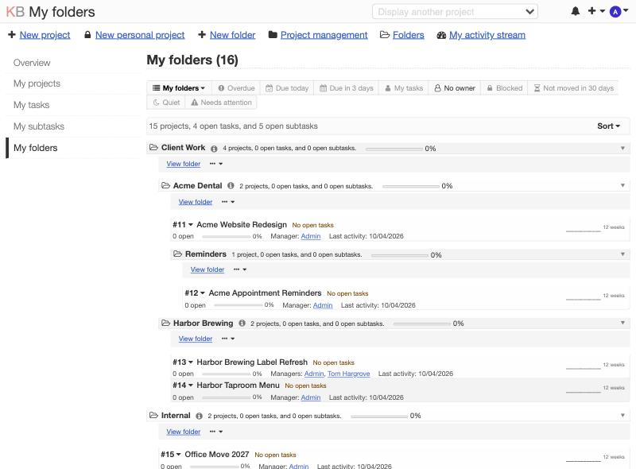
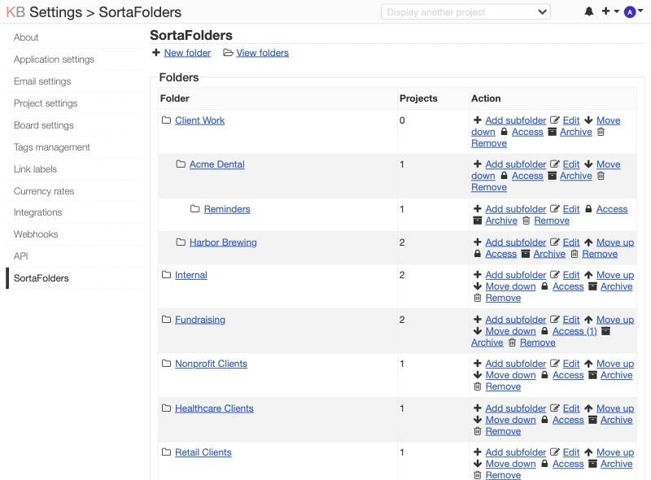

# SortaFolders v1.0.2

*SortaFolders* is a Kanboard plugin that sorts projects into folders. Kanboard doesn't let you group projects together or classify a project by putting it in another project, so *SortaFolders* adds nestable folders up to 5 levels deep and a dedicated *My folders* page on your dashboard that lists your projects by folder.

With *SortaFolders*, admins and project managers can sort their projects into folders, add a note per folder, and add folder descriptions, and admins can grant access to users and groups who are in a project to the other projects in that same folder.

Admins can also change the icon used to represent folders from a list of options, hide folders from view, and change the site-wide term *SortaFolders* uses for folders to Clients, Departments, Folders (*default*), Portfolios, Products, Programs, Project groups, and Spaces. For example, I like to pair the "Spaces" with the globe icon and "Portfolio" with the briefcase icon on my Kanboard sites.

On the *My folders* page, any user of any project that's sorted in a folder can see that folder's note, some stats about their projects, tasks, and subtasks, and sparklines and progress bars. Stats are gathered from all the projects in the folder the user can see and are displayed as a total.

*SortaFolders* works without any other plugins installed, but if you have the [BigBoard fork by mrsuner](https://github.com/mrsuner/kanboard_plugin_bigboard) installed, *SortaFolders* adds a row of BigBoard links and tabs to all your *My* dashboard pages.

## Screenshots

The *My folders* page at `/folders` (or `/spaces`, and so on, with the term an admin picks) shows your projects grouped by folder. Select *View folder* or use the `…` menu to open it.

*Settings -> SortaFolders* lists every folder with its project count and all the admin actions.

## Quick start

1. Copy the `SortaFolders` folder into Kanboard's `plugins/` directory.
2. Open *Settings -> SortaFolders* (or select "Folders management" from the avatar menu) as an admin, and click "New folder". Add subfolders from the same page, from the main header menu, or from the "+" menu.
3. Open a project, click "Configure this project", click "Edit folder" in the project settings sidebar, choose a folder, and click "Save".
4. Click *My folders* in the dashboard sidebar to see your projects sorted by folder.
5. To sort a project into a folder as you create it, choose a folder in the New project form.

[INSTALL.md](INSTALL.md) covers the requirements, removal, and compatibility.

## Folders and folder notes

- Folders can be nested up to 5 levels deep.
- Admins and project managers can create folders. A project manager chooses a parent folder from the folders they can see. Only admins can rename, move, reorder and remove folders. Edit a folder to rename it or to choose a different parent folder, and use the up and down arrows to change its order.
- Removing a folder deletes nothing but the folder. Its subfolders and projects move up one level, and projects in a top level folder end up in the "No folder" section.
- A folder note is a short text note (up to 280 characters) with a configurable green, yellow, or red flag that appears on the *My folders* page. Admins and project managers with a project sorted in a folder can add a note to the folder, and anyone with a project sorted in that folder can see it. A project's Edit folder page shows a history of that folder's notes. Removing a folder also removes its notes.
- A "Hidden folders" list on the admin settings page hides a folder, its subfolders, and the projects sorted in them from everyone but admins (who see everything).
- Admins can see hidden folders and any folders inside of them as *Name (hidden)*. The admin settings page still lists every hidden folder in the folder list and in the "Access" section.
- A folder can have a description up to 2,000 characters, and Markdown is supported. The folder description shows in the info icon's hover text on the folder page, just like Kanboard's project descriptions.
- "Archive" on the admin settings page will close every active project (including personal projects) sorted in the to-be-archived folder. All the tasks are left alone, and just the project is closed. "Unarchive" will undo it and reopens every closed project in the folder and its subfolders. A project can also be reopened on Kanboard's Projects page.

## Project health and filters

- A project is highlighted in red and shows an alert when its open tasks that are overdue reaches a configurable percentage, or when it has been quiet for a configurable number of days. It is highlighted in yellow when it has an overdue task, a task due soon, or has been quiet for a configurable number of days. Otherwise it is highlighted in green. A project with no open task has no project health and says "No open tasks".
- "Quiet" is the days since the project's last task activity. A project at or past a configurable number of days shows "Quiet for N days".
- The four configurable project health numbers are on the *Settings -> SortaFolders* admin settings page: the red percentage (25), the red quiet days (30), the yellow quiet days (14) and how many days count as "due soon" (7).
- A "Projects in folders needing attention" section displays up to 5 "red" or "yellow" projects if there are any. "Red" first, then the most overdue, then the longest quiet, and with the folder path and the reason. Turn it on or off under "Project health" on the admin settings page.
- Each project row has a 12-week activity sparkline.
- A row of tabs with useful searches shows on the *My folders*, *My projects*, *My tasks*, and *My subtasks* pages: All, Overdue, Due today, Due this week, My tasks, No owner, Blocked, Not moved in 30 days, Quiet, and Needs attention. "Due this week" reads "Due in N days" when the "due soon" number is not 7. When the [BigBoard fork by mrsuner](https://github.com/mrsuner/kanboard_plugin_bigboard) is installed, every tab BigBoard can search gets a dropdown to switch to BigBoard with views that search directly in BigBoard. If a tab is dimmed, it's because nothing currently comes up for that search.

## Folder access

Access control features are completely optional. If you don't use the access control features, adding users remains Kanboard's job on the project's *Settings -> Permissions* page. SortaFolders only sorts projects into folders, and no memberships get added or removed.

The "Access" section on the *Settings -> SortaFolders* admin settings page, however, gives a user or a group a project role (viewer, member, or manager) on every project in a folder and its subfolders, both now and for projects put in that folder later. This is great for setting up a user with access to a number of projects without needing to add them to each project one at a time.

To check on who can open each folder's projects and where the access came from:

- A lock means access was given by folder access (and says which folder the grant is on "from this folder" or "from the parent folder").
- A user icon means a user was manually added to a project by admin.
- A users icon means a group was added manually by an admin.

A user with different roles on two projects in the same folder shows both ("Manager on #5, Member on #6"). Admins see everything and are not listed, and closed and personal projects are not shown.

Use cases for an admin:

- A client's account manager, bookkeeper, or lead who must be on every project of that client: grant the role once on the client's folder.
- A group such as Finance or an outside auditor who reads every project in a portfolio: grant "viewer" to the group on the portfolio folder.
- A contractor who works on one client only: grant "member" on that client's folder and nowhere else.
- A department head who runs everything in a department's folder: grant "manager" on that folder.
- A standing team (group) for a client: an admin who sorted a new project in a folder can give the team access to it.
- Offboarding: remove the access grant, and the user is removed from every project the folder added them to. Memberships added manually by an admin will remain.
- A reorganization: move a project to another folder, and the old folder's users and groups leave it and the new folder's users and groups arrive with it.

Use cases for a project manager:

- Sort a new project in the right folder, and the folder's standing team appears on it without needing to add members manually. The New project form and the Edit folder page tell an admin who that is, but a project manager sees no names.
- Move a project out of a folder to remove the folder's grantees access to that project.
- Create a folder for their own work. It won't have any access until an admin grants it.

A project manager who sorts a project in a folder gives the folder's grantees access to that project. That's how access grants spread, so give "manager" on a folder only to someone who should manage every project in it.

- Only admins can add or remove access. It becomes an ordinary project membership, so it shows on each project's Permissions page.
- SortaFolders remembers the memberships it added. When the access is removed, the folder is removed, or a project leaves the folder, it removes those memberships and nothing else. A membership someone added manually is never changed or removed, and neither is one whose role a project manager has changed since.
- A user who already has a role (or a higher privileged one) on a project through a group is left alone, since Kanboard reads a user's own role before their group's.
- Personal projects are ignored.
- Access applies when a project is sorted through SortaFolders (via the New project form or the project's Edit folder page) and when access or the folder tree changes. Sorting through Kanboard's API (`saveProjectMetadata`) goes through SortaFolders, too. Opening a folder's Access dialog also runs it, which repairs any project that was sorted some other way.
- A duplicate of a project inherits the members it copied, and SortaFolders adopts the ones the access added, so removing the access (or moving the copy out of the folder) takes them off the copy, too. It does this by listing the access IDs in a project metadata key, `sortafolders_applied`, which Kanboard copies with the project. Only SortaFolders writes that key, and the API refuses it.
- If the user or group a grant is for is deleted, the grant is deleted with it at the next run.
- The New project form and the project's Edit folder page shows admins a list of users and groups with their role that each folder gives access to.

## Folder description

A "Show a project's folder description" admin setting on the *Settings -> SortaFolders* page shows a project's own folder description in a box under the project header on the board and the other project views. A folder with no description, a closed project, and a project in no folder show nothing, and a parent folder's description isn't repeated on its subfolders' projects.

## BigBoard links on the dashboard

If the [BigBoard fork by mrsuner](https://github.com/mrsuner/kanboard_plugin_bigboard) is installed, the Overdue, Due today, Due this week, My tasks, No owner, Blocked, and Not moved in 30 days items each have a dropdown with BigBoard menu items. All, Quiet, and Needs attention don't get them, since BigBoard doesn't have search filters for those. What the item opens depends on the page:

| Page | "Switch to BigBoard" opens |
|---|---|
| *My projects* | The search, on the projects you picked in BigBoard |
| *My tasks* | The same search, narrowed to tasks assigned to you ("No owner" is always dimmed, since an unowned task is never yours) |
| *My subtasks* | The same search, but BigBoard can't search by subtask assignee, so it finds tasks you own |

On the *My folders* page, each folder's links menu has "Open this folder in BigBoard" (it follows the folder term, as in "Open this space in BigBoard") and one item for each search, narrowed to that folder, and the ones with nothing to find are dimmed. BigBoard shows the folder's projects, and its group switcher uses the folder term (see "What it overrides"). The tabs on the *My folders* page narrow the list, and a clicked tab is saved per user when its link's token comes with it, which a tab link always adds. "Clear" shows the full list again.

Every folder and project row shows a progress bar based on tasks that are closed in that folder's projects (and any subfolder's projects), and a project row also shows its project managers and the date of last activity.

Kanboard core reserves the Summary and Time tracking pages of other users to admins, and SortaFolders doesn't change that. The "Sort" menu orders the projects inside each folder by ID, name, last activity, start date, end date, and public or personal. Folders have the order set on the admin settings page.

Each folder has its own page (with pretty URLs like */folders/16*, or */spaces/16* with the term "Spaces"; `/folders/16` keeps working) headed by its path, "Folders ›" and the folder names, each parent a link. The page lists 25 top-level folders or ungrouped projects at a time, with Kanboard core's Previous and Next links.

## Limitations

- A project can only be sorted into one folder.
- MySQL, MariaDB, and SQLite only.
- English only. Contributions are welcome.
- The Projects page and the dashboard *My projects* list uses Kanboard's own order and aren't grouped, but SortaFolders adds a badge with the project's icon and folder name.
- Duplicating a project copies its folder only when you choose to copy the project's metadata, too.
- BigBoard works with SortaFolders, and its group switcher and its "Selected projects" choice follow the folder term, including "Unsorted projects".
- BigBoard checks to see if there's a plugin called PortfolioDashboard and a `PortfolioProjectModel` class name, and SortaFolders uses that class name to integrate with BigBoard's "Selected projects" menu. If a PortfolioDashboard plugin is installed, though, or another plugin declares a class with that name, SortaFolders leaves it alone and BigBoard's group switcher lists that plugin's groups instead of your folders. A plugin that declares the same class name after SortaFolders has started can crash with "Cannot declare class".
- A hidden folder's projects leave BigBoard's "Selected projects" list only on a BigBoard that asks SortaFolders through a `bigboard:projects:ids` hook. mrsuner's BigBoard fork has no such hook yet, so it still lists them.
- Kanboard's own project list, search, and board switcher can't be narrowed without overriding core, so they still list the projects in a hidden folder for the people who are members, and members still open those projects. Project permissions don't change, though, and only the folder is hidden. When an admin hides a folder, the user who made a folder or was given access to it will lose sight of it.

## What it overrides

SortaFolders doesn't change any Kanboard core files or other plugin files.

Kanboard's JSON-RPC API lets any member of a project and not only a manager set its metadata, so SortaFolders takes over `saveProjectMetadata` and `removeProjectMetadata` for the folder only. The same rule is applied on the Edit folder page. Every other metadata key works as before.

The tab bars come from SortaFolders' copy of core's `dashboard/layout` template file (Kanboard 1.2.54) with one line added. If Kanboard changes that template file, compare the copy at `Template/dashboard/layout.php`. Another plugin that overrides `dashboard/layout` can also take over from this one.

SortaFolders overrides:

| Part | How |
|---|---|
| Template `dashboard/layout` | The plugin's copy adds support for BusyBee questions and BigBoard links and tabs at the top of the *My projects*, *My tasks*, and *My subtasks* pages, and for BusyBee questions at the top of *Overview*. *My folders* gets the same hooks from the plugin's own folder page. Core's pages, controller and queries are not modified, and the tabs narrow the lists through core's `pagination:dashboard:*:query` hooks |
| `sortafolders_groups`, `sortafolders_access`, `sortafolders_access_applied` and `sortafolders_notes` tables | Created by the plugin's schema on first load |
| `sortafolders_group` and `sortafolders_applied` project metadata | The first holds a project's folder id, the second the ids of the access grants that added members (see "Folder access") |
| `sortafolders_` settings and `sortafolders_filter` user setting | The term, icon, hidden folders, folder description and health numbers are Kanboard settings, and each user's last filter tab is kept in their user metadata, but only when the tab's link carries Kanboard's reusable CSRF token, which the tabs add. A filter in an address without it applies to that page view and isn't saved |
| `sortaFolderModel` service and `sortaFolders` helper | New names, so nothing is replaced |
| Hooks | `template:config:sidebar`, `template:project-list:menu:after`, `template:dashboard:sidebar`, `template:dashboard:page-header:menu`, `template:header:creation-dropdown`, `template:header:dropdown`, `template:project:creation:form`, `template:project:sidebar`, `template:dashboard:project:after-title`, `template:project:header:before`, `template:project:header:after`, `template:layout:css` and `template:layout:js`. It renders `template:sortafolders:folder:before-tabs` and `template:sortafolders:dashboard:before-tabs` for BusyBee, and it listens for `bigboard:projects:ids`, which a BigBoard with that hook runs, to take the projects of hidden folders out of BigBoard's "Selected projects" list |
| Shutdown function | After the response to a signed-in user's New project form that contains a folder, it sorts the new project, because Kanboard 1.2 has no project-created event. It does nothing for any other request |
| BigBoard labels | At startup it adds entries to the translation table for BigBoard's "Portfolio group", "Selected projects" and "Ungrouped projects" strings so they follow the term setting ("Selected spaces", "Selected project groups"), and renames "Ungrouped projects" to "Unsorted projects" |
| BigBoard's group list | At startup it makes the PortfolioDashboard plugin's `PortfolioProjectModel` class name point at SortaFolders' `FolderModel`, which has the same `getProjectGrouping()`, so mrsuner's BigBoard (which looks for that class) shows a group switcher fed by the folders. It does nothing when PortfolioDashboard is installed. With mrsuner's BigBoard the dropdown shows, but choosing a folder does nothing until two bugs in its switcher are fixed (an inline `onchange` that Kanboard's Content-Security-Policy blocks, and a doubly escaped address) |
| JavaScript | `Assets/js/sortafolders.js` remembers which folders are closed in the browser's `localStorage` and moves the "Edit folder" item to sit under "Edit project", because Kanboard has no hook at that spot |
| Access rules | The folder admin controller (except creating a folder, which a project manager may do) and the folder access controller need an admin, the project folder controller needs a project manager, and the note controller needs a signed-in user and then checks the folder itself |

## Compatibility

- Kanboard >= 1.2.54 (the only version it has been tested on)
- Four new tables, `sortafolders_groups`, `sortafolders_access`, `sortafolders_access_applied` and `sortafolders_notes` (UTF-8 with 4-byte characters on MySQL, so emoji in names work)

## Other plugins

SortaFolders works by itself and plays nicely with several other plugins by the same author:

- [BusyBee](https://github.com/christefano/BusyBee) adds one-click questions about your projects and tasks, such as "What is late?" and "What is blocked?", to the top of Kanboard's *My* dashboard pages. If SortaFolders is installed, the same questions also show at the top of its *My folders* page.
- [CommentTater](https://github.com/christefano/CommentTater) lets you update a task's fields while posting a comment. Changes made to the task from the comment are shown on the posted comment and are included in Kanboard email notifications, too.
- [NotifyMe](https://github.com/christefano/NotifyMe) emails you about your own actions in a project, adds a vacation mode, notifies users of failed login attempts, and gives admins control of how many notifications are shown in the Notifications menu. Its email footer uses NotKanboard's name when both are installed.
- [NotKanboard](https://github.com/christefano/NotKanboard) helps whitelabel Kanboard and replaces "Kanboard" in page titles, outgoing emails, and a few other places with your own product name.
- [TagAlong](https://github.com/christefano/TagAlong) supercharges Kanboard email support by filtering autoreplies, email signatures, and quoted text from incoming mail, points Reply-To to the reply-by-email address, and adds a reply token to email subjects, so replies become task comments through [Mailmagik](https://github.com/creecros/Mailmagik/).

## License

GNU General Public License v2. See LICENSE for details.
